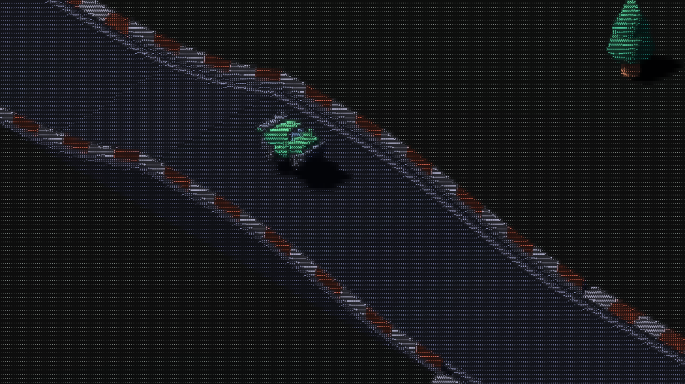
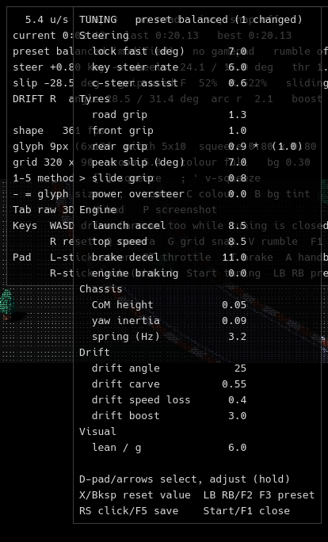
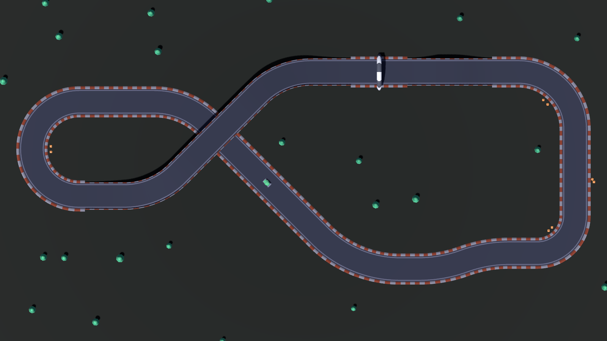

# ASCII Racer

A 3D toy-car racing game where every pixel on screen is a text character. The world is a real 3D scene with real car physics; a custom renderer turns each frame into a grid of coloured ASCII glyphs.

It is a prototype, in the spirit of 90s top-down racers, built with [Godot 4.7](https://godotengine.org/).

**[Play in the browser](https://eiwe.github.io/ascii-racer/)** (experimental web build; desktop Chrome or Firefox), or download it for Windows, Linux or macOS below.


| On the start line | Mid-air over the jump | Rear chase camera |
|---|---|---|
|  |  |  |

## What's in it

- **ASCII renderer**: every character is chosen by matching its shape to what is inside its cell, with adjustable glyph size and a "squeeze" control that packs characters tighter than their natural size so they overlap for extra detail.
- **Car physics**: a rigid body on four raycast wheels with spring suspension, tyre grip limits and a friction circle, running on Jolt at 120 Hz.
- **Arcade drift**: handbrake while steering kicks the car into a held, steerable drift with a small exit boost. Drifting also refills the nitro.
- **Nitro**: a 1.5-second tank on Left Shift or a left-stick click, with an on-screen bar. Burning it in a corner is a mistake you can make.
- **A limit worth respecting**: the tight corners (the hairpin, the two 90-degree right-handers) need real braking, and overdriving one runs you wide. The default `balanced` setup is planted; the `drift` preset is the one whose rear steps out on the throttle or a lift, where a countersteer can catch it and ignoring it spins you.
- **Four handling presets** (`balanced`, `drift`, `grip`, `heavy`) plus a live tuning panel; your own setup saves as `custom`.
- **Circuits**: Figure Eight, a 147-unit figure-of-eight with a bridge, a table-top jump, sweepers and a hairpin, and a first draft of Dust Bowl, a dirt oval with banked turns, a double and a step-down jump. Lap timer with current, last and best lap (the first lap from the lights is a standing start; without the lights, as in the scripted tests, it starts at the line); the best lap is kept per circuit.
- **Level select**: after the reel, pick the circuit on a live preview that circles it, its time of day (morning, noon or night) and the opponent.
- **Two cameras**: fixed isometric (default) and a rear chase view with right-stick look-around. Switching between them is a short eased camera move (a dolly zoom), not a cut.
- **Nine lighting modes** on keys `1`–`9`: a sunset sky with clouds (the reel's), night with headlights, the classic look, a low golden-hour sun with long shadows, hatched shadows, a glint on the car, a moving sun, morning and noon.
- **Night racing** (lighting `2`, experimental): moonlight with the track edges still readable, headlight beams that light the road ahead and throw moving shadows, red tail lamps that brighten under braking, on both cars and in the demo reel, under a sky with a moon and stars.
- **Isometric zoom that fits the window**: in the default AUTO zoom, a 16:9 or narrower window looks further ahead and zooms out a little, so it shows at least as much road ahead as an ultrawide, with calm, heavily smoothed camera motion. Fixed zoom steps (car centred) are in the pause menu.
- **F1-style start lights**: every start from the grid (from the reel, a restart, or turning the opponent on) runs five red lights with a beep each, a random hold, then lights out with a higher beep. The cars are held until then (the throttle still revs the engine), the race music and the lap timer start at lights out, and the opponent reacts after about 0.45 s at level 1 down to about 0.15 s at level 5.
- **An AI opponent**: a red speedster that starts beside you on the grid and laps freely, at a difficulty from 1 to 5 (or off) set in the pause menu. It drives the same car with the same `balanced` setup as you, with no catch-up: higher levels simply drive closer to the limit, and levels 4 and 5 drift the hairpin and use nitro. Contact is solid, and your position and the gap in seconds show at the bottom left.
- **Sound and music**: a recorded petrol engine with a simulated gearbox, tyre squeal, landings, impacts and nitro, plus menu and race music. A pause menu on `Esc` has volume controls that are saved between runs.
- **Gamepad support** with analogue steering and triggers, and rumble.
- **Demo reel**: the game opens on a self-driving reel shot from changing camera angles, with a logo intro made of characters. Press anything for the level select.

## Download and play

Grab a build from the [latest release](../../releases/latest), or **[play in the browser](https://eiwe.github.io/ascii-racer/)**.

| Platform | File | Notes |
|---|---|---|
| Windows (x86-64) | `ascii-racer-<version>-windows-x86_64.zip` | Unzip and run `ascii-racer.exe`. Unsigned, so SmartScreen shows "More info → Run anyway" the first time. |
| Linux (x86-64) | `ascii-racer-<version>-linux-x86_64.tar.gz` | Extract and run `./ascii-racer.x86_64`. |
| macOS (Intel and Apple Silicon) | `ascii-racer-<version>-macos-universal.zip` | Unzip and open `ASCII Racer.app`. Not notarised: see [First launch on macOS](#first-launch-on-macos). |
| Web browser (experimental) | [eiwe.github.io/ascii-racer](https://eiwe.github.io/ascii-racer/), or `ascii-racer-<version>-web.zip` | Play it online, or unzip and serve the folder from a web server (opening `index.html` from disk does not work); see [Web build](#web-build). |

The desktop builds need a GPU with Vulkan (Windows, Linux), Direct3D 12 (Windows) or Metal (macOS). The web build needs a desktop browser with WebGL 2 (current Chrome or Firefox).

### Web build

The web build is the same game running in the browser on Godot's Compatibility renderer (WebGL 2), which the desktop builds do not use. To try it locally:

```sh
tools/serve_web.sh            # serves build/web/ at http://127.0.0.1:8060/
```

It runs from any static web host without special headers (it is the single-threaded build). The download is about 22 MB zipped; the browser loads a 40 MB WebAssembly engine (10 MB if the server compresses it) and a 12 MB game data file. Known differences from the desktop builds:

- **The picture is close but not identical.** The Compatibility renderer lights scenes differently (it adds shadowed lights in sRGB space, uses simpler diffuse shading and its own light falloff), so the lighting modes are rebalanced for it. Classic and the isometric views match closely; night and the chase view's far distance differ most. The normal and depth information the character shapes come from is drawn a different way, with the same result.
- **Sound, keyboard and gamepad work** in Chrome and in a Firefox-based browser (tested by the owner). Gamepad rumble in the browser has not been checked.
- **A start screen first.** Browsers keep a page silent until it is clicked or a key is pressed, so the web build opens on the logo with "click or press any key"; that click or key switches the sound on and starts the demo reel and its music from the top (it does not start a race). A gamepad button cannot switch sound on in a browser, so the screen asks for a click or key. If the browser already allows sound, the screen is skipped.
- **High-density displays**: characters are a little larger than on the desktop builds and sized for the display's pixel density (12 px on a 1x display, 16 px on a 2x display such as a Retina Mac, in between for 1.25x and 1.5x), and so is the HUD text; this follows browser zoom and moves between monitors.
- **Settings are kept in the browser**: the volumes, mute, selected circuit with its time of day, opponent level and best lap, zoom, glyph size and the saved `custom` handling are stored by the game in the browser's site storage (IndexedDB) and, as a backup that is written the moment you save, in its localStorage. Clearing the site's data resets them.
- **Night looks a little different** (the headlight pool and the kerbs inside it); it is fully playable.
- **No Quit** in the menu (close the tab), no command-line options, and settings and custom tuning are kept in the browser's storage for the site.
- **Esc** opens the menu and also leaves the browser's fullscreen.

The hosted copy at [eiwe.github.io/ascii-racer](https://eiwe.github.io/ascii-racer/) is the `gh-pages` branch: `tools/deploy_pages.sh` replaces it with the current `build/web/` as a single fresh commit (so the large engine file does not pile up in history), and `tools/release.sh --publish` runs it after creating a release.

### First launch on macOS

The macOS build is not signed with an Apple Developer ID, so macOS blocks it the first time. Use any one of these:

- **Approve it in Settings.** Open `ASCII Racer.app` and dismiss the warning. Then open System Settings → Privacy & Security, scroll to the message about ASCII Racer, and click **Open Anyway**. You only need to do this once.
- **Remove the quarantine mark in Terminal.** After unzipping, run this once, adjusting the path to wherever the app is:

  ```sh
  xattr -dr com.apple.quarantine ~/Downloads/"ASCII Racer.app"
  ```

- **Download from Terminal instead of a browser.** Files fetched with `curl` or `gh` are not quarantined, so there is no prompt:

  ```sh
  gh release download --repo eiwe/ascii-racer --pattern '*macos*'
  ```

On macOS 14 and earlier you can also right-click the app and choose Open. That shortcut was removed in macOS 15.

## Controls

The game opens on the demo reel. Press any key, button or trigger for the level select, then Enter, Space or pad A to start driving (see [Level select](#level-select)). Before the first start lights a note under the start gantry shows, for five seconds, the key (and the pad button, with a gamepad connected) that switches between the isometric and chase cameras; it then fades and the same shortcut stays in the small legend in the top left corner, next to the debug menu's. `Esc` (or Start on a gamepad) opens the menu: resume, restart, change track (back to the level select), the opponent's difficulty on this circuit (off or 1 to 5, applied when the menu closes), the isometric zoom (AUTO, or a fixed 0.85 to 1.50 times the base framing), volume sliders for master, music and effects, a sound check that plays each sound on its own, return to the title, and quit. The selected circuit, each circuit's time of day, opponent difficulty and best lap, the zoom, volumes and mute, the glyph size you set with `-` / `=`, and a saved `custom` handling preset are kept between runs; the glyph size is kept at the same physical size if you move to a display of a different density, and stepping back to the default size forgets it. Not kept between runs: a lighting mode picked with the number keys and the sun position, the camera (isometric or chase) and the chase distance, the base isometric zoom (`,` `.`), squeeze, colour mode, background tint, grid snap, rumble, the debug HUD, and the selected handling preset (only `custom` is saved, with F5). Opening the menu during the start lights pauses them; they carry on where they were when it closes (Restart begins them again). The reset key does nothing under the lights.

### Level select

| Action | Keyboard | Gamepad |
|---|---|---|
| Previous / next circuit (preview row) | Left / right, or A / D | D-pad or left stick |
| Move between the preview, time of day, opponent and START | Up / down, or W / S | D-pad or left stick |
| Change the time of day or opponent (on its row) | Left / right | D-pad or left stick |
| Start | Enter or Space | A or Start |
| Back to the reel | Esc | B or Back |

The arrows wrap round the circuits. In the browser the arrows, the rows and START can also be clicked. The title music carries on through the level select; the race music starts at lights out. Above the rows: the circuit's name, its length, surface, features and your best lap there.

### Driving

| Action | Keyboard | Gamepad |
|---|---|---|
| Steer | A / D, or arrow keys | Left stick |
| Throttle | W, or up arrow | Right trigger |
| Brake / reverse | S, or down arrow | Left trigger |
| Handbrake / drift | Space | A |
| Nitro (hold) | Left Shift | Left-stick click |
| Reset to the road | R | Y |
| Switch camera | Q | B |
| Look around (chase view) | | Right stick |
| Rumble on/off | V | |
| Menu / pause | Esc | Start |
| Mute | M | |

To drift, press the handbrake while steering at speed. Hold it, or tap it and keep the throttle on with the stick toward the inside. The stick sets how tight the arc is. Letting go or counter-steering ends the drift.

### Handling

| Action | Keyboard | Gamepad |
|---|---|---|
| Next / previous preset | F3 / F2 | RB / LB |
| Open the tuning panel | F1 | Back |
| Select a value | Up / down arrows | D-pad up / down |
| Adjust it (hold to repeat) | Left / right arrows | D-pad left / right |
| Reset it to the preset | Backspace | X |
| Save as `custom` | F5 | Right-stick click |

The debug HUD (speed, lap times, telemetry, render settings and every key) starts minimised: a small legend in the top left corner, `H  debug menu    Q  camera`, shows how to open it and how to switch cameras. It is hidden in the demo reel and the menu.

While the tuning panel is open the arrow keys navigate it, so drive with WASD.



### Rendering

| Key | Action |
|---|---|
| `1`–`9` | Lighting mode: sunset, night, classic, low sun, hatched, glint, sweep, morning, noon |
| `J` / `L` | Swing the sun round (the moon at night; not in classic) |
| `I` / `K` | Raise / lower the sun (the moon at night; not in classic) |
| `[` / `]` | Squeeze characters together / apart (both axes) |
| `;` / `'` | Vertical squeeze only |
| `-` / `=` | Glyph size (remembered between runs) |
| `,` / `.` | Zoom (isometric: the base that AUTO and the menu's steps multiply) or camera distance (chase) |
| `C` | Full colour or mono ink |
| `B` | Background tint behind glyphs |
| `G` | Snap the isometric camera to the character grid |
| `Tab` | Raw 3D view, for comparison |
| `H` | Show / hide the debug HUD |
| `P` | Save a screenshot to the user data folder |

## Run from source

You need Godot **4.7** (the project uses the Forward+ renderer and Jolt physics, both built in).

```sh
git clone <this repo>
cd ascii-racer
godot --path . --import     # first time only: imports the models and fonts
godot --path .              # run the game
```

Useful options, passed after `--`:

| Command | What it does |
|---|---|
| `godot --path . -- --play` | Skip the demo reel and the level select and start on the grid of the saved circuit in its saved time of day. |
| `godot --path . -- --play --track=dust_bowl --time=noon` | The same on a given circuit (`figure_eight`, `dust_bowl`) and time of day (`morning`, `noon`, `night`). |
| `godot --path . -- --lighting=low-sun` | Start in a lighting mode (name or number 1–9; overrides the time of day). |
| `godot --path . -- --preset=drift` | Start on a handling preset (`balanced`, `drift`, `grip`, `heavy`). |
| `godot --path . -- --tune=top_speed=9,grip_road=1.4` | Override car tunables for one run. |
| `godot --path . res://demo/demo.tscn` | The renderer demo: a small diorama with a scripted car. |

## How the renderer works

The renderer lives in `ascii/` and is independent of the game. `AsciiRenderer` is a node; anything placed under it is rendered as ASCII. Each frame goes through these stages:

1. **Scene**: the 3D world renders normally into an off-screen viewport at reduced resolution.
2. **G-buffer**: a second viewport renders the same world and exports view-space normals and linear depth. Under Forward+ (the desktop builds) a full-screen pass reads them from the depth and normal buffers. The Compatibility renderer (the web build) has no normal buffer, so there every visible mesh gets an unshaded twin that only the g-buffer camera sees and that writes its normal and depth directly (`ascii/shaders/gbuffer_twin.gdshader`).
3. **Cells**: a shader runs once per character cell, samples the colour and g-buffer over that cell, and decides which glyph to print and in what ink.
4. **Compose**: a full-resolution shader draws each pixel from the glyph atlas. With squeeze below 1 the glyph boxes overlap, so up to 3×3 neighbouring cells contribute to a pixel and are combined by per-channel maximum, like overprinting.

An optional **overlay layer** (`AsciiOverlay`, from `AsciiRenderer.get_overlay()`) lets a script write glyphs straight into the cell grid, on top of the scene: one glyph and ink colour per cell, plus a background that can dim or replace the scene cell behind it. The logo, the corner title and the start prompt are drawn this way, so they are made of the same characters as everything else. With the overlay off the output is unchanged.

The glyph atlas is built at runtime from the font, so glyph size can change live. For each glyph it also measures overall coverage and a 2×3 "shape vector" of where the ink sits.

**Choosing the glyph.** Each cell takes six brightness samples in a 2 × 3 grid and picks the glyph whose shape vector is nearest, so the character follows the structure inside the cell: a diagonal edge becomes `/`, a bright lower half becomes `_`. Cells with no structure fall back to a brightness ramp sorted by ink coverage. Earlier versions offered four other methods (plain ramp, edge lines, overstrike, hatch by surface direction); they were removed in 0.3 in favour of this one.

All settings are on the `AsciiSettings` resource (`ascii/ascii_settings.gd`). The defaults are 9 px glyphs, squeeze 0.8 × 0.8, full colour and background tint 0.3. On a Retina Mac the game starts at 20 px glyphs instead, because 9 px is too small to read at that pixel density.

### Lighting modes

Lighting is defined as data in `lighting/lighting.gd`: each mode is a table of sun direction, colour and energy, fill light, ground and track brightness, shadow settings, and switches for the extra effects. Both the game and the renderer demo build their sun and environment from it.

| Key | Mode | What it does |
|---|---|---|
| `1` | sunset | The default. Low sun with the glint, under a sunset sky: a gradient from deep blue to an orange horizon, the sun itself, and fair-weather cumulus. The sky is drawn as characters like everything else, and far scenery fades into it. It only shows where the camera sees sky (the chase view and the reel's cinematic shots), not in the isometric view. |
| `2` | night | Experimental. Cool moonlight with a fill strong enough that the road, kerbs and walls still draw as characters beyond the headlights; each car has a shadowed headlight beam (a wide warm pool reaching about a braking distance ahead), glowing head and tail lamps and a red glow behind that brightens under braking. In the chase and reel views, a night sky with the moon (where the moonlight comes from, so `J`/`L`/`I`/`K` move it) and stars; the sky cells use fill glyphs only, so a star stays one dot instead of turning into letters. |
| `3` | classic | The original lighting (the default up to 0.3). Its output is kept pixel-identical from release to release. |
| `4` | low sun | A low, warm sun with long hard-edged shadows and a cool fill. |
| `5` | hatched | Low sun, with shadow drawn as its own texture: sparse `/` hatching in a cool ink and a line glyph along the shadow edge. Uses an extra lighting-only render pass, which exists only while this mode is on. |
| `6` | glint | Low sun, plus a small highlight that slides over the car's bodywork and a cool rim light. |
| `7` | sweep | Low sun that circles once a minute, so the shadows swing round. |
| `8` | morning | The level select's default time of day. A low warm sun from the east with long shadows, a cool blue fill and a dawn sky (deep blue overhead, peach at the horizon). |
| `9` | noon | A high, near-white sun with short shadows under a blue sky with white cumulus; the sun and fill are kept moderate so the road and kerbs still draw as characters instead of washing out. |

The level select's times of day are modes `8` (morning), `9` (noon) and `2` (night). A circuit can adjust them in its data (`time_tweaks`: any key of the mode's table, such as the sun's direction or colour). The demo reel always runs on Figure Eight in sunset.

Light shafts were tried and dropped: Godot's volumetric fog does not work with the orthographic camera, and in the chase view the shafts did not survive the conversion to characters.

## Project layout

| Path | Contents |
|---|---|
| `ascii/` | The renderer: `ascii_renderer.gd`, `ascii_settings.gd`, `glyph_atlas.gd`, `ascii_overlay.gd` (the overlay cell layer), `ascii_controls.gd` (render keys and HUD panel), `shaders/`. |
| `game/` | The game: car physics and nitro (`car.gd`), presets and save file (`car_tuning.gd`), tuning panel, the circuits as data (`tracks.gd`), driving surfaces (`surfaces.gd`), track generator (`track.gd`), the level select (`level_select.gd`), cameras and the move between them (`view_blend.gd`), lap timer, rumble, the nitro bar (`nitro_hud.gd`), the pause menu (`pause_menu.gd`), the start lights (`race_start.gd`), the AI opponent (`opponent.gd`: the red car, its recovery and the race standing; `opponent_driver.gd`: its driving per level; `shaders/opponent_paint.gdshader`: its red paint), sound (`audio/`: the sample table, mixer, music looping and the car's engine, tyre and impact sounds), and the scripted drive test. The demo reel lives here too: `attract.gd` (reel state), `logo.gd` (logo, title and prompt), `demo_driver.gd` (the self-driving car), `shot_director.gd` and `cine_camera.gd` (the camera shots). |
| `lighting/` | The lighting modes (`lighting.gd`), the car glint shader, the sunset and night skies (`sunset_sky.gdshader`, `night_sky.gdshader`) and the cars' night lights (`car_lights.gd`). |
| `demo/` | The renderer demo scene and its screenshot-capture mode. |
| `assets/` | Car and prop models, fonts, and `audio/` (music, sound effects, the sample table `sounds.cfg` and `CREDITS.md`). |
| `docs/` | Images used in this README and the release notes for each version. |
| `tools/` | `release.sh` (builds and publishes releases), `make_hero.sh` (re-records the README's hero animation and logo image), `prepare_audio.py` (cuts, loops and levels the sound effects from their source recordings) and `measure_audio.py` (loudness and pitch measurements of recorded game audio). |

### Editing the track

Circuits are data in `game/tracks.gd` (one dictionary per circuit, listed in `Tracks.ALL`); `game/track.gd` generates the road, kerbs, walls, bridge and colliders from it, and the world rebuilds when the circuit changes. A definition has:

- `layout`: straights `["S", length]` and arcs `["A", radius, degrees]` (positive turns right) walked from `origin` at `start_heading_deg`. Two straights have length `-1` and are solved so the loop closes; they must not be parallel.
- `elevation`: ranges of raised road `{from, to, rise: [y0, y1], shape}` with shapes `ease`, `kick` (a jump's lip) and `flat`; `deck` marks a bridge span (only circuits with a bridge get the see-through halo) and `jump` marks a jump, which the AI drivers take flat out. A table-top, a double and a step-down are sequences of these.
- `bank`: banked ranges `{from, to, deg, ease_in, ease_out}`; the outside of the turn rises by `deg`, easing in and out over the given lengths. Banked road is built raised, with walls, so its low edge sits at ground level; the road, its edges and the walls roll together.
- `surface` and `patches`: the road's surface and patches of another one, full width or part width (`u: [from, to]` across the road, negative to the left). Surfaces are defined in `game/surfaces.gd`: grip, how early and how softly the tyre lets go, grip left while sliding, drag, colour and tyre-sound family. Asphalt and the off-track ground use the car's own tunables, so the handling on Figure Eight is unchanged. Each wheel reads the surface under it.
- `start_s`, `checkpoints`, `kerbs`, `theme` (trees, cones, the start gate), `time_tweaks`, and `name` and `description` for the level select.

The AI drivers (the reel's and the opponent's) plan their line and speeds from this data, including the grip of the surface and the extra speed a banked turn allows. Road width, kerb size, wall height and colours are constants in `track.gd`.

The demo reel's camera shots are defined relative to the track in `game/shot_director.gd` (distance along the centre line, sideways offset, height), so they follow layout changes.



### Editing the logo

Everything that defines the logo is at the top of `game/logo.gd`: the letter bitmaps, glyph choices, colours, size and position, and each step of the intro (decode, speed lines, glint, hold, exit) with its timing and an on/off switch.

### Editing the handling

Every tunable is an exported property on `Car` (`game/car.gd`), grouped by Chassis, Suspension, Engine and brakes, Steering, Tyres, Drift, Nitro, Air and Visual. Presets are dictionaries of overrides in `game/car_tuning.gd`. Values saved from the tuning panel go to `car_tuning.cfg` in Godot's user data folder for the project. A `custom` preset saved before 0.3 keeps the older, slower values it was saved with, and one saved in 0.3 keeps 0.3's lower top speed and road grip.

### Editing the sound

`assets/audio/sounds.cfg` maps each role (engine loops with their rpm, tyre squeal and skid, landing, kerb, impacts, nitro, the start-light beeps, menu and race music) to a file and a gain, so swapping a sound is a one-line change. The effect files are produced from their source recordings by `tools/prepare_audio.py`, which records the exact ranges used (the two start beeps are synthesised tones: `tools/prepare_audio.py --beeps` rewrites just those); the sources and licences are listed in `assets/audio/CREDITS.md`. The engine's gearbox exists only in the sound: it makes the revs rise and drop through five gears and does not affect the physics.

## Testing

There are no unit tests. Scripted modes stand in for them, and all of them need a real window (Godot's `--headless` mode does not render). Add `--audio-driver Dummy` before `--path` to run them silently.

**Drive test**: drives the car with scripted inputs and writes measurements and screenshots.

```sh
godot --path . --fixed-fps 120 -- --drivetest=/tmp/drive
godot --path . --fixed-fps 120 -- --drivetest=/tmp/drive --preset=heavy --dtonly=spawn,jump,lap
```

It writes `results.txt` and PNGs to the given folder and quits. Unless a scenario changes it, it drives Figure Eight. It covers top speed, braking, each corner's clean speed, behaviour past the limit, the drift, the nitro, the jump, the bridge, kerbs, collisions, reset, pausing, gamepad bindings, the lighting modes, autopilot laps and the demo reel's driver (`--dtonly=demo_laps`).

The opponent has its own scenarios: `opp_laps` (each level alone over a run of laps: lap times, resets, stuck time; `--opplevels=1,5` and `--opplaps=10` narrow it), `opp_block` (your car parked on the racing line and across the hairpin exit), `opp_shove` (a scripted hit), `opp_start` (both cars off the grid together), `opp_menu` (off / on / level changes from the menu, saved setting) and `opp_shots` (screenshots).

Scripted runs (the drive test, `--attracttest`, `--attractshots`, the hero recording) skip the start lights. The `countdown` scenario turns them on: the cars do not move before lights out while the throttle is blipped, nitro cannot be used, the hold differs between starts, the lap timer starts at lights out, the opponent's reaction at levels 1 and 5 and its first corner, pausing and cancelling mid-sequence, no nodes or sound players left behind, and screenshots (two, three and five lamps and just after lights out, in iso and chase, on the Retina grid and at night).

Three more scenarios cover the night lighting, the zoom and the HUD: `night` (screenshots at night where visibility matters, iso and chase: the grid, flat out on the straight, braking for the hairpin, the R6 after the jump, under the bridge, the opponent ahead and behind; `--nightmode=<n>` shoots another mode at the same places), `view_ahead` (road visible ahead of the car along its heading at 16:9, 16:10 and 21:9, standing and flat out, with the fixed 1.00 zoom and with AUTO, the car's size on screen, and how smoothly AUTO's zoom moves over a lap) `hud_shots` (window captures of the minimised HUD's legend and the open HUD over the start lights), `camera_motion` (how calm the isometric camera is over a lap with the reel's driver and with the level-5 opponent, in a 16:9 output, AUTO and fixed: the camera's acceleration and jerk, the car's offset and speed on screen and its direction reversals, also through the hairpin and the esses; `--camtune=<name>=<value>,...` tries other camera settings), `camera_tip` (the camera note before the first lights: when it shows, that Restart and the opponent do not bring it back, dismissing it, screenshots) and `gate` (the finish gate's colliders against its legs, deliberate hits, and contacts over laps of the reel driver and the opponent at every level).

Four scenarios cover the circuits and the views: `level_select` (screenshots of each time of day at 16:9 and 21:9, changing circuit through the wipe, the opponent row), `tracks` (building Dust Bowl, its surfaces and banked cross-section, laps by the autopilot and the reel's driver, the level-5 opponent, and that switching back and forth leaves no nodes behind), `camera_blend` (frames of the move to the chase view and back, that it never overshoots and ends on the right camera, and a reversal mid-move) and `time_of_day` (each time's lighting mode, the time saved per circuit, a circuit's tweaks, keys 1–9 while driving, and the reel returning to sunset on Figure Eight). `night --nightmode=8` and `--nightmode=9` shoot morning and noon at the night scenario's places.

**Audio**: nobody can listen in a scripted run, so the mix is checked by recording it. `--dtonly=audio` under Godot's movie writer saves the game's audio for scripted scenarios, and `tools/measure_audio.py` reports loudness per layer, clipping and the engine's pitch over time.

**Look regression**: renders the demo scene with fixed presets, so renderer changes can be compared image by image. Files are named `<zoom>_<squeeze>_<n>_<mode>.png`; the classic mode (`*_3_classic.png`) is the byte-identity reference.

```sh
godot --path . res://demo/demo.tscn -- --capture=/tmp/capture
```

**Demo reel**: checks the way from the reel through the level select into a race and back with injected input (every kind of press opens the level select, Enter or pad A starts, Esc and pad B go back to the reel, the pause menu's CHANGE TRACK and TO TITLE), or saves frames of the logo intro and the reel for review.

```sh
godot --path . -- --attracttest=/tmp/attract
godot --path . --fixed-fps 60 -- --attractshots=/tmp/attract-frames --attractsize=1100x760
```

## Building releases

Install the Godot export templates matching your Godot version, then:

```sh
tools/release.sh 0.4             # build and package Windows, Linux, macOS and the web build
tools/release.sh 0.4 --publish   # also tag v0.4, push, and create the GitHub release
```

The script sets the version, exports Windows, Linux, macOS and the web build, smoke-tests the Linux build, and writes the archives and `SHA256SUMS.txt` to `build/release/<version>/`. A missing or incomplete export of any target stops it. With `--publish` it needs a clean working tree and an authenticated `gh`; release notes are taken from `docs/releases/<version>.md` if that file exists.

The presets are in `export_presets.cfg`. All four targets build from Linux. Windows and Linux embed the game data in the executable; the web build is a folder (`index.html`, `index.js`, `index.wasm`, `index.pck` and a few small files). To export a single target by hand:

```sh
godot --headless --path . --export-release "Linux" build/linux/ascii-racer.x86_64
godot --headless --path . --export-release "Web" build/web/index.html
```

The web build runs on the Compatibility renderer (`rendering/renderer/rendering_method.web` in `project.godot`); the desktop builds stay on Forward+. To see what the browser will show without exporting, run the project with `--rendering-method gl_compatibility`.

## Limitations

- **Most of the handling and the sound were tuned by measurement.** The `balanced` defaults were set by hand by the owner; the other presets, the limit behaviour, the nitro and the audio mix were set up against scripted tests and recordings, with limited hands-on driving and listening so far.
- **Some sounds come from lossy previews.** The engine's idle and mid-rev loops, the landing thump and the kerb knock were cut from Freesound's public preview files, because the originals need a login. There is no recording above about 2,600 rpm, so the top of the rev range is that loop pitched up. `assets/audio/CREDITS.md` marks which files these are.
- **The `heavy` preset bottoms out on the jump landing.**
- **The opponent is a rival on the road, not yet a race.** There is a start, but no lap count, finish or results, and no jump-start penalty (the car is simply held until lights out): both cars lap freely after the lights. Its engine is quieter and fades with distance but is not panned left or right, and only its engine is heard (no tyre or nitro sounds of its own).
- **The Retina default is new in 0.2.** On a Retina Mac the game now starts with larger glyphs and HUD text. If the characters still look too small or too large, adjust them with `-` and `=`.
- **The Windows build has only been run under Wine**, not on a Windows PC.
- **The web build is experimental.** It looks close to the desktop builds but not the same (see [Web build](#web-build)); rumble in the browser is untested.
- **Glyph flicker.** As the camera moves, glyphs change. Grid snapping (`G`) reduces this for the static world in the isometric view but does not remove it, and it does not apply to the chase view. In the sunset mode it helps less when the isometric view is zoomed out (AUTO in a 16:9 window, or the menu's steps above 1.00): the grid-snap measurement goes from about 1% of cells changing at the base zoom to about 3% under AUTO at 16:9. The other modes are not affected.
- **Night is experimental.** It is tuned so the road edges stay readable beyond the headlights, but the far side of a corner outside the beam is sparse, and an opponent's beam from behind washes out the player's car in the chase view.
- **AUTO zoom moves the car off centre.** At speed in a 16:9 window the car sits behind the centre of the screen and is drawn about a tenth smaller than at the base zoom; a fixed step in the menu keeps it centred at a constant size.
- **One track and one car model** for the player (the AI opponent drives a second, red car), with one opponent at a time.

## Credits and licences

- **Models**: [Toy Car Kit](https://kenney.nl/assets/toy-car-kit) by Kenney, [CC0](https://creativecommons.org/publicdomain/zero/1.0/). See `assets/kenney_toy-car-kit/License.txt`.
- **Font**: [Hack](https://sourcefoundry.org/hack/), patched by [Nerd Fonts](https://www.nerdfonts.com/); MIT and Bitstream Vera licences. See `assets/fonts/LICENSE-Hack.md`.
- **Sound effects**: recordings by qubodup, audible-edge (Tom Haigh), j_soundeffects, kd33n, Dorian Clair (BigSoundBank), Kenney, and effects from the USC Cinema / Sunset Editorial collection via the Internet Archive, under CC BY 3.0, CC BY 4.0 and CC0. Full sources, licences and attribution lines are in [`assets/audio/CREDITS.md`](assets/audio/CREDITS.md).
- **Music**: supplied by the project owner.
- **Engine**: [Godot Engine](https://godotengine.org/), MIT.

The project's own code and scenes are released under the [MIT License](LICENSE). The bundled models and fonts keep their own licences, listed above.
