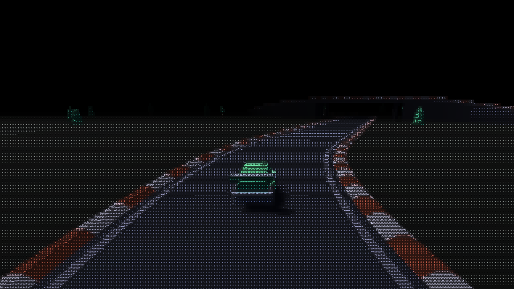

# ASCII Racer

A 3D toy-car racing game where every pixel on screen is a text character. The world is a real 3D scene with real car physics; a custom renderer turns each frame into a grid of coloured ASCII glyphs.

It is a prototype, in the spirit of 90s top-down racers, built with [Godot 4.7](https://godotengine.org/).


| Mid-air over the jump | Rear chase camera |
|---|---|
|  |  |

## What's in it

- **ASCII renderer**: five glyph-selection methods switchable live, adjustable glyph size, and a "squeeze" control that packs characters tighter than their natural size so they overlap for extra detail.
- **Car physics**: a rigid body on four raycast wheels with spring suspension, tyre grip limits and a friction circle, running on Jolt at 120 Hz.
- **Arcade drift**: handbrake while steering kicks the car into a held, steerable drift with a small exit boost.
- **Four handling presets** (`balanced`, `drift`, `grip`, `heavy`) plus a live tuning panel; your own setup saves as `custom`.
- **One circuit**: a 147-unit figure-of-eight with a bridge, a table-top jump, sweepers and a hairpin. Lap timer with current, last and best lap.
- **Two cameras**: fixed isometric (default) and a rear chase view with right-stick look-around.
- **Gamepad support** with analogue steering and triggers, and rumble.

## Download and play

Grab a build from the [latest release](../../releases/latest).

| Platform | File | Notes |
|---|---|---|
| Windows (x86-64) | `ascii-racer-0.1-windows-x86_64.zip` | Unzip and run `ascii-racer.exe`. Unsigned, so SmartScreen shows "More info → Run anyway" the first time. |
| Linux (x86-64) | `ascii-racer-0.1-linux-x86_64.tar.gz` | Extract and run `./ascii-racer.x86_64`. |
| macOS (Intel and Apple Silicon) | `ascii-racer-0.1-macos-universal.zip` | Unzip and open `ASCII Racer.app`. Not notarised: approve it under System Settings → Privacy & Security on first launch. On Retina displays the characters start out very small in 0.1; press `=` a few times to enlarge them. |

The game needs a GPU with Vulkan (Windows, Linux), Direct3D 12 (Windows) or Metal (macOS). There is no web build; see [Limitations](#limitations).

## Controls

### Driving

| Action | Keyboard | Gamepad |
|---|---|---|
| Steer | A / D, or arrow keys | Left stick |
| Throttle | W, or up arrow | Right trigger |
| Brake / reverse | S, or down arrow | Left trigger |
| Handbrake / drift | Space | A |
| Reset to the road | R | Y or Back |
| Switch camera | Q | B |
| Look around (chase view) | | Right stick |
| Rumble on/off | V | |

To drift, press the handbrake while steering at speed. Hold it, or tap it and keep the throttle on with the stick toward the inside. The stick sets how tight the arc is. Letting go or counter-steering ends the drift.

### Handling

| Action | Keyboard | Gamepad |
|---|---|---|
| Next / previous preset | F3 / F2 | RB / LB |
| Open the tuning panel | F1 | Start |
| Select a value | Up / down arrows | D-pad up / down |
| Adjust it (hold to repeat) | Left / right arrows | D-pad left / right |
| Reset it to the preset | Backspace | X |
| Save as `custom` | F5 | Right-stick click |

While the tuning panel is open the arrow keys navigate it, so drive with WASD.


### Rendering

| Key | Action |
|---|---|
| `1`–`5` | Method: ramp, edges, shape, overstrike, hatch |
| `[` / `]` | Squeeze characters together / apart (both axes) |
| `;` / `'` | Vertical squeeze only |
| `-` / `=` | Glyph size |
| `,` / `.` | Zoom (isometric) or camera distance (chase) |
| `C` | Full colour or mono ink |
| `B` | Background tint behind glyphs |
| `G` | Snap the isometric camera to the character grid |
| `Tab` | Raw 3D view, for comparison |
| `H` | Hide the HUD |
| `P` | Save a screenshot to the user data folder |

## Run from source

You need Godot **4.7** (the project uses the Forward+ renderer and Jolt physics, both built in).

```sh
git clone <this repo>
cd ascii-racer
godot --path . --import     # first time only: imports the models and fonts
godot --path .              # run the game
```

Useful options, passed after `--`:

| Command | What it does |
|---|---|
| `godot --path . -- --preset=drift` | Start on a handling preset (`balanced`, `drift`, `grip`, `heavy`). |
| `godot --path . -- --tune=top_speed=9,grip_road=1.4` | Override car tunables for one run. |
| `godot --path . res://demo/demo.tscn` | The renderer demo: a small diorama with a scripted car. |

## How the renderer works

The renderer lives in `ascii/` and is independent of the game. `AsciiRenderer` is a node; anything placed under it is rendered as ASCII. Each frame goes through four stages:

1. **Scene**: the 3D world renders normally into an off-screen viewport at reduced resolution.
2. **G-buffer**: a second viewport renders the same world and exports view-space normals and linear depth.
3. **Cells**: a shader runs once per character cell, samples the colour and g-buffer over that cell, and decides which glyph to print and in what ink. This is where the five methods differ.
4. **Compose**: a full-resolution shader draws each pixel from the glyph atlas. With squeeze below 1 the glyph boxes overlap, so up to 3×3 neighbouring cells contribute to a pixel and are combined by per-channel maximum, like overprinting.

The glyph atlas is built at runtime from the font, so glyph size can change live. For each glyph it also measures overall coverage and a 2×3 "shape vector" of where the ink sits.

| Method | How a glyph is chosen |
|---|---|
| ramp | Cell brightness picks from a ramp sorted by ink coverage. |
| edges | Ramp fill, with line glyphs along silhouettes and creases found in the g-buffer. |
| shape (default) | Six brightness samples per cell are matched against every glyph's shape vector, so the glyph follows the structure inside the cell. |
| overstrike | Two glyphs per cell: ramp fill with an edge glyph printed on top. |
| hatch | Glyph family chosen by which way the surface faces, density by brightness. |

All settings are on the `AsciiSettings` resource (`ascii/ascii_settings.gd`). The defaults are the shape method, 9 px glyphs, squeeze 0.8 × 0.8, full colour and background tint 0.3.

## Project layout

| Path | Contents |
|---|---|
| `ascii/` | The renderer: `ascii_renderer.gd`, `ascii_settings.gd`, `glyph_atlas.gd`, `ascii_controls.gd` (render keys and HUD panel), `shaders/`. |
| `game/` | The game: car physics (`car.gd`), presets and save file (`car_tuning.gd`), tuning panel, track generator (`track.gd`), cameras, lap timer, rumble, autopilot and the scripted drive test. |
| `demo/` | The renderer demo scene and its screenshot-capture mode. |
| `assets/` | Car and prop models, fonts. |
| `docs/images/` | Screenshots used in this README. |

### Editing the track

The circuit is generated from data at the top of `game/track.gd`, not built from model pieces:

- `LAYOUT` is a list of straights `["S", length]` and arcs `["A", radius, degrees]` (positive turns right) walked from the start. Two straights have length `-1` and are solved so the loop closes.
- `ELEVATION` raises ranges of the centre line for the bridge ramps, the bridge deck and the jump.
- Road width, kerb size, wall height and colours are constants in the same file.


### Editing the handling

Every tunable is an exported property on `Car` (`game/car.gd`), grouped by Chassis, Suspension, Engine and brakes, Steering, Tyres, Drift, Air and Visual. Presets are dictionaries of overrides in `game/car_tuning.gd`. Values saved from the tuning panel go to `car_tuning.cfg` in Godot's user data folder for the project.

## Testing

There are no unit tests. Two scripted modes stand in for them, and both need a real window (Godot's `--headless` mode does not render).

**Drive test**: drives the car with scripted inputs and writes measurements and screenshots.

```sh
godot --path . --fixed-fps 120 -- --drivetest=/tmp/drive
godot --path . --fixed-fps 120 -- --drivetest=/tmp/drive --preset=heavy --dtonly=spawn,jump,lap
```

It writes `results.txt` and PNGs to the given folder and quits. It covers top speed, braking, turn radii, the drift, the jump, the bridge, kerbs, collisions, reset, gamepad bindings and autopilot laps.

**Look regression**: renders the demo scene with fixed presets, so renderer changes can be compared image by image.

```sh
godot --path . res://demo/demo.tscn -- --capture=/tmp/capture
```

## Building releases

Install the Godot export templates matching your Godot version, then:

```sh
tools/release.sh 0.2             # build and package all three platforms
tools/release.sh 0.2 --publish   # also tag v0.2, push, and create the GitHub release
```

The script sets the version, exports Windows, Linux and macOS, smoke-tests the Linux build, and writes the archives and `SHA256SUMS.txt` to `build/release/<version>/`. With `--publish` it needs a clean working tree and an authenticated `gh`; release notes are taken from `docs/releases/<version>.md` if that file exists.

The presets are in `export_presets.cfg`. All three targets build from Linux. Windows and Linux embed the game data in the executable. To export a single target by hand:

```sh
godot --headless --path . --export-release "Linux" build/linux/ascii-racer.x86_64
```

## Limitations

- **The handling was tuned by measurement.** The presets, drift and jump were set up against the scripted drive test, with limited hands-on driving so far.
- **Glyphs are too small on Retina displays in 0.1.** The default glyph size is set for standard-density screens, so on a Retina Mac the characters are hard to make out until you enlarge them with `=`. A Retina-aware default is planned for the next release.
- **The Windows build has only been run under Wine**, not on a Windows PC.
- **No web build.** Godot's web export only supports its Compatibility renderer, and the g-buffer stage relies on a Forward+ feature (reading scene normals in a shader). That stage would need porting.
- **Glyph flicker.** As the camera moves, glyphs change. Grid snapping (`G`) reduces this for the static world in the isometric view but does not remove it, and it does not apply to the chase view.
- **One track, one car, no opponents, no sound.**

## Credits and licences

- **Models**: [Toy Car Kit](https://kenney.nl/assets/toy-car-kit) by Kenney, [CC0](https://creativecommons.org/publicdomain/zero/1.0/). See `assets/kenney_toy-car-kit/License.txt`.
- **Font**: [Hack](https://sourcefoundry.org/hack/), patched by [Nerd Fonts](https://www.nerdfonts.com/); MIT and Bitstream Vera licences. See `assets/fonts/LICENSE-Hack.md`.
- **Engine**: [Godot Engine](https://godotengine.org/), MIT.

The project's own code and scenes are released under the [MIT License](LICENSE). The bundled models and fonts keep their own licences, listed above.
