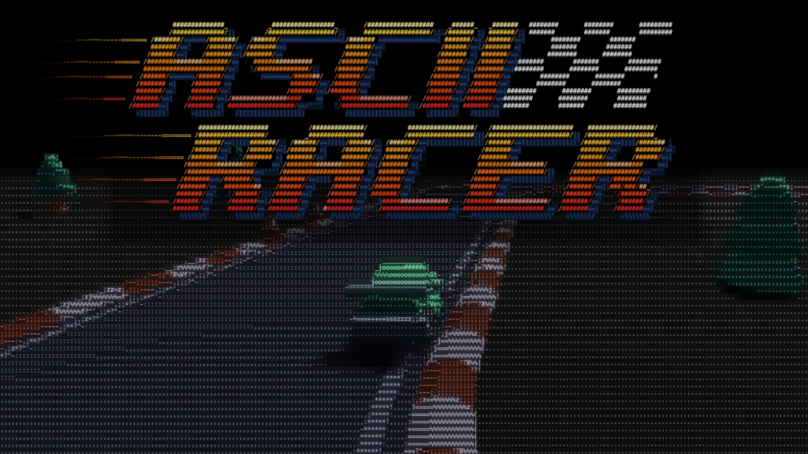
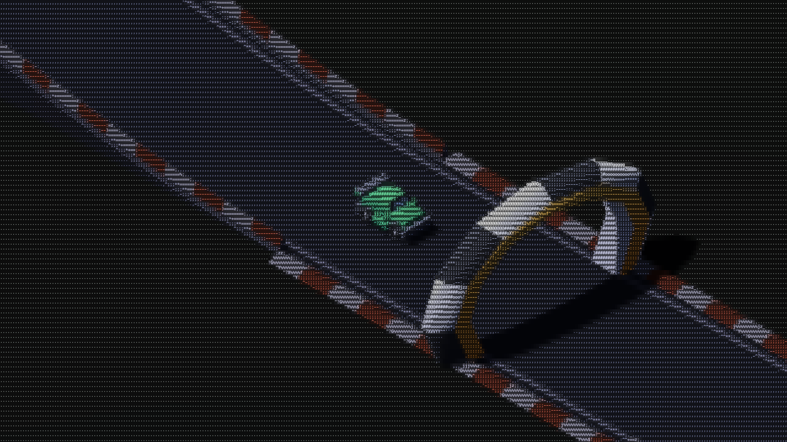

# ASCII Racer

A 3D toy-car racing game where every pixel on screen is a text character. The world is a real 3D scene with real car physics; a custom renderer turns each frame into a grid of coloured ASCII glyphs.

It is a prototype, in the spirit of 90s top-down racers, built with [Godot 4.7](https://godotengine.org/).




| On the start line | Mid-air over the jump | Rear chase camera |
|---|---|---|
|  |  |  |

## What's in it

- **ASCII renderer**: every character is chosen by matching its shape to what is inside its cell, with adjustable glyph size and a "squeeze" control that packs characters tighter than their natural size so they overlap for extra detail.
- **Car physics**: a rigid body on four raycast wheels with spring suspension, tyre grip limits and a friction circle, running on Jolt at 120 Hz.
- **Arcade drift**: handbrake while steering kicks the car into a held, steerable drift with a small exit boost. Drifting also refills the nitro.
- **Nitro**: a 1.5-second tank on Left Shift or a left-stick click, with an on-screen bar. Burning it in a corner is a mistake you can make.
- **A limit worth respecting**: the circuit can no longer be driven flat. Overdrive a corner and the car slides; a countersteer can catch it, and ignoring it spins you.
- **Four handling presets** (`balanced`, `drift`, `grip`, `heavy`) plus a live tuning panel; your own setup saves as `custom`.
- **One circuit**: a 147-unit figure-of-eight with a bridge, a table-top jump, sweepers and a hairpin. Lap timer with current, last and best lap.
- **Two cameras**: fixed isometric (default) and a rear chase view with right-stick look-around.
- **Five lighting modes** on keys `1`–`5`: the classic look, a low golden-hour sun with long shadows, hatched shadows, a glint on the car, and a moving sun.
- **Sound and music**: a recorded petrol engine with a simulated gearbox, tyre squeal, landings, impacts and nitro, plus menu and race music. A pause menu on `Esc` has volume controls that are saved between runs.
- **Gamepad support** with analogue steering and triggers, and rumble.
- **Demo reel**: the game opens on a self-driving reel shot from changing camera angles, with a logo intro made of characters. Press anything to play.

## Download and play

Grab a build from the [latest release](../../releases/latest).

| Platform | File | Notes |
|---|---|---|
| Windows (x86-64) | `ascii-racer-<version>-windows-x86_64.zip` | Unzip and run `ascii-racer.exe`. Unsigned, so SmartScreen shows "More info → Run anyway" the first time. |
| Linux (x86-64) | `ascii-racer-<version>-linux-x86_64.tar.gz` | Extract and run `./ascii-racer.x86_64`. |
| macOS (Intel and Apple Silicon) | `ascii-racer-<version>-macos-universal.zip` | Unzip and open `ASCII Racer.app`. Not notarised: see [First launch on macOS](#first-launch-on-macos). |

The game needs a GPU with Vulkan (Windows, Linux), Direct3D 12 (Windows) or Metal (macOS). There is no web build; see [Limitations](#limitations).

### First launch on macOS

The macOS build is not signed with an Apple Developer ID, so macOS blocks it the first time. Use any one of these:

- **Approve it in Settings.** Open `ASCII Racer.app` and dismiss the warning. Then open System Settings → Privacy & Security, scroll to the message about ASCII Racer, and click **Open Anyway**. You only need to do this once.
- **Remove the quarantine mark in Terminal.** After unzipping, run this once, adjusting the path to wherever the app is:

  ```sh
  xattr -dr com.apple.quarantine ~/Downloads/"ASCII Racer.app"
  ```

- **Download from Terminal instead of a browser.** Files fetched with `curl` or `gh` are not quarantined, so there is no prompt:

  ```sh
  gh release download --repo eiwe/ascii-racer --pattern '*macos*'
  ```

On macOS 14 and earlier you can also right-click the app and choose Open. That shortcut was removed in macOS 15.

## Controls

The game opens on the demo reel. Press any key, button or trigger to start driving. `Esc` (or Start on a gamepad) opens the menu: resume, restart, volume sliders for master, music and effects, a sound check that plays each sound on its own, return to the title, and quit.

### Driving

| Action | Keyboard | Gamepad |
|---|---|---|
| Steer | A / D, or arrow keys | Left stick |
| Throttle | W, or up arrow | Right trigger |
| Brake / reverse | S, or down arrow | Left trigger |
| Handbrake / drift | Space | A |
| Nitro (hold) | Left Shift | Left-stick click |
| Reset to the road | R | Y |
| Switch camera | Q | B |
| Look around (chase view) | | Right stick |
| Rumble on/off | V | |
| Menu / pause | Esc | Start |
| Mute | M | |

To drift, press the handbrake while steering at speed. Hold it, or tap it and keep the throttle on with the stick toward the inside. The stick sets how tight the arc is. Letting go or counter-steering ends the drift.

### Handling

| Action | Keyboard | Gamepad |
|---|---|---|
| Next / previous preset | F3 / F2 | RB / LB |
| Open the tuning panel | F1 | Back |
| Select a value | Up / down arrows | D-pad up / down |
| Adjust it (hold to repeat) | Left / right arrows | D-pad left / right |
| Reset it to the preset | Backspace | X |
| Save as `custom` | F5 | Right-stick click |

While the tuning panel is open the arrow keys navigate it, so drive with WASD.


### Rendering

| Key | Action |
|---|---|
| `1`–`5` | Lighting mode: classic, low sun, hatched, glint, sweep |
| `J` / `L` | Swing the sun round (lighting 2–5) |
| `I` / `K` | Raise / lower the sun (lighting 2–5) |
| `[` / `]` | Squeeze characters together / apart (both axes) |
| `;` / `'` | Vertical squeeze only |
| `-` / `=` | Glyph size |
| `,` / `.` | Zoom (isometric) or camera distance (chase) |
| `C` | Full colour or mono ink |
| `B` | Background tint behind glyphs |
| `G` | Snap the isometric camera to the character grid |
| `Tab` | Raw 3D view, for comparison |
| `H` | Hide the HUD |
| `P` | Save a screenshot to the user data folder |

## Run from source

You need Godot **4.7** (the project uses the Forward+ renderer and Jolt physics, both built in).

```sh
git clone <this repo>
cd ascii-racer
godot --path . --import     # first time only: imports the models and fonts
godot --path .              # run the game
```

Useful options, passed after `--`:

| Command | What it does |
|---|---|
| `godot --path . -- --play` | Skip the demo reel and start on the grid. |
| `godot --path . -- --lighting=low-sun` | Start in a lighting mode (name or number 1–5). |
| `godot --path . -- --preset=drift` | Start on a handling preset (`balanced`, `drift`, `grip`, `heavy`). |
| `godot --path . -- --tune=top_speed=9,grip_road=1.4` | Override car tunables for one run. |
| `godot --path . res://demo/demo.tscn` | The renderer demo: a small diorama with a scripted car. |

## How the renderer works

The renderer lives in `ascii/` and is independent of the game. `AsciiRenderer` is a node; anything placed under it is rendered as ASCII. Each frame goes through these stages:

1. **Scene**: the 3D world renders normally into an off-screen viewport at reduced resolution.
2. **G-buffer**: a second viewport renders the same world and exports view-space normals and linear depth.
3. **Cells**: a shader runs once per character cell, samples the colour and g-buffer over that cell, and decides which glyph to print and in what ink.
4. **Compose**: a full-resolution shader draws each pixel from the glyph atlas. With squeeze below 1 the glyph boxes overlap, so up to 3×3 neighbouring cells contribute to a pixel and are combined by per-channel maximum, like overprinting.

An optional **overlay layer** (`AsciiOverlay`, from `AsciiRenderer.get_overlay()`) lets a script write glyphs straight into the cell grid, on top of the scene: one glyph and ink colour per cell, plus a background that can dim or replace the scene cell behind it. The logo, the corner title and the start prompt are drawn this way, so they are made of the same characters as everything else. With the overlay off the output is unchanged.

The glyph atlas is built at runtime from the font, so glyph size can change live. For each glyph it also measures overall coverage and a 2×3 "shape vector" of where the ink sits.

**Choosing the glyph.** Each cell takes six brightness samples in a 2 × 3 grid and picks the glyph whose shape vector is nearest, so the character follows the structure inside the cell: a diagonal edge becomes `/`, a bright lower half becomes `_`. Cells with no structure fall back to a brightness ramp sorted by ink coverage. Earlier versions offered four other methods (plain ramp, edge lines, overstrike, hatch by surface direction); they were removed in 0.3 in favour of this one.

All settings are on the `AsciiSettings` resource (`ascii/ascii_settings.gd`). The defaults are 9 px glyphs, squeeze 0.8 × 0.8, full colour and background tint 0.3. On a Retina Mac the game starts at 20 px glyphs instead, because 9 px is too small to read at that pixel density.

### Lighting modes

Lighting is defined as data in `lighting/lighting.gd`: each mode is a table of sun direction, colour and energy, fill light, ground and track brightness, shadow settings, and switches for the extra effects. Both the game and the renderer demo build their sun and environment from it.

| Key | Mode | What it does |
|---|---|---|
| `1` | classic | The original lighting and the default. Its output is kept pixel-identical from release to release. |
| `2` | low sun | A low, warm sun with long hard-edged shadows and a cool fill. |
| `3` | hatched | Low sun, with shadow drawn as its own texture: sparse `/` hatching in a cool ink and a line glyph along the shadow edge. Uses an extra lighting-only render pass, which exists only while this mode is on. |
| `4` | glint | Low sun, plus a small highlight that slides over the car's bodywork and a cool rim light. |
| `5` | sweep | Low sun that circles once a minute, so the shadows swing round. |

Light shafts were tried and dropped: Godot's volumetric fog does not work with the orthographic camera, and in the chase view the shafts did not survive the conversion to characters.

## Project layout

| Path | Contents |
|---|---|
| `ascii/` | The renderer: `ascii_renderer.gd`, `ascii_settings.gd`, `glyph_atlas.gd`, `ascii_overlay.gd` (the overlay cell layer), `ascii_controls.gd` (render keys and HUD panel), `shaders/`. |
| `game/` | The game: car physics and nitro (`car.gd`), presets and save file (`car_tuning.gd`), tuning panel, track generator (`track.gd`), cameras, lap timer, rumble, the nitro bar (`nitro_hud.gd`), the pause menu (`pause_menu.gd`), sound (`audio/`: the sample table, mixer, music looping and the car's engine, tyre and impact sounds), and the scripted drive test. The demo reel lives here too: `attract.gd` (reel state), `logo.gd` (logo, title and prompt), `demo_driver.gd` (the self-driving car), `shot_director.gd` and `cine_camera.gd` (the camera shots). |
| `lighting/` | The lighting modes (`lighting.gd`) and the car glint shader. |
| `demo/` | The renderer demo scene and its screenshot-capture mode. |
| `assets/` | Car and prop models, fonts, and `audio/` (music, sound effects, the sample table `sounds.cfg` and `CREDITS.md`). |
| `docs/` | Images used in this README and the release notes for each version. |
| `tools/` | `release.sh` (builds and publishes releases), `make_hero.sh` (re-records the README's hero animation and logo image), `prepare_audio.py` (cuts, loops and levels the sound effects from their source recordings) and `measure_audio.py` (loudness and pitch measurements of recorded game audio). |

### Editing the track

The circuit is generated from data at the top of `game/track.gd`, not built from model pieces:

- `LAYOUT` is a list of straights `["S", length]` and arcs `["A", radius, degrees]` (positive turns right) walked from the start. Two straights have length `-1` and are solved so the loop closes.
- `ELEVATION` raises ranges of the centre line for the bridge ramps, the bridge deck and the jump.
- Road width, kerb size, wall height and colours are constants in the same file.

The demo reel's camera shots are defined relative to the track in `game/shot_director.gd` (distance along the centre line, sideways offset, height), so they follow layout changes.


### Editing the logo

Everything that defines the logo is at the top of `game/logo.gd`: the letter bitmaps, glyph choices, colours, size and position, and each step of the intro (decode, speed lines, glint, hold, exit) with its timing and an on/off switch.

### Editing the handling

Every tunable is an exported property on `Car` (`game/car.gd`), grouped by Chassis, Suspension, Engine and brakes, Steering, Tyres, Drift, Nitro, Air and Visual. Presets are dictionaries of overrides in `game/car_tuning.gd`. Values saved from the tuning panel go to `car_tuning.cfg` in Godot's user data folder for the project. A `custom` preset saved before 0.3 keeps the older, slower and grippier values it was saved with.

### Editing the sound

`assets/audio/sounds.cfg` maps each role (engine loops with their rpm, tyre squeal and skid, landing, kerb, impacts, nitro, menu and race music) to a file and a gain, so swapping a sound is a one-line change. The effect files are produced from their source recordings by `tools/prepare_audio.py`, which records the exact ranges used; the sources and licences are listed in `assets/audio/CREDITS.md`. The engine's gearbox exists only in the sound: it makes the revs rise and drop through five gears and does not affect the physics.

## Testing

There are no unit tests. Scripted modes stand in for them, and all of them need a real window (Godot's `--headless` mode does not render). Add `--audio-driver Dummy` before `--path` to run them silently.

**Drive test**: drives the car with scripted inputs and writes measurements and screenshots.

```sh
godot --path . --fixed-fps 120 -- --drivetest=/tmp/drive
godot --path . --fixed-fps 120 -- --drivetest=/tmp/drive --preset=heavy --dtonly=spawn,jump,lap
```

It writes `results.txt` and PNGs to the given folder and quits. It covers top speed, braking, each corner's clean speed, behaviour past the limit, the drift, the nitro, the jump, the bridge, kerbs, collisions, reset, pausing, gamepad bindings, the lighting modes, autopilot laps and the demo reel's driver (`--dtonly=demo_laps`).

**Audio**: nobody can listen in a scripted run, so the mix is checked by recording it. `--dtonly=audio` under Godot's movie writer saves the game's audio for scripted scenarios, and `tools/measure_audio.py` reports loudness per layer, clipping and the engine's pitch over time.

**Look regression**: renders the demo scene with fixed presets, so renderer changes can be compared image by image.

```sh
godot --path . res://demo/demo.tscn -- --capture=/tmp/capture
```

**Demo reel**: checks starting from the reel and returning to it with injected input, or saves frames of the logo intro and the reel for review.

```sh
godot --path . -- --attracttest=/tmp/attract
godot --path . --fixed-fps 60 -- --attractshots=/tmp/attract-frames --attractsize=1100x760
```

## Building releases

Install the Godot export templates matching your Godot version, then:

```sh
tools/release.sh 0.4             # build and package all three platforms
tools/release.sh 0.4 --publish   # also tag v0.4, push, and create the GitHub release
```

The script sets the version, exports Windows, Linux and macOS, smoke-tests the Linux build, and writes the archives and `SHA256SUMS.txt` to `build/release/<version>/`. With `--publish` it needs a clean working tree and an authenticated `gh`; release notes are taken from `docs/releases/<version>.md` if that file exists.

The presets are in `export_presets.cfg`. All three targets build from Linux. Windows and Linux embed the game data in the executable. To export a single target by hand:

```sh
godot --headless --path . --export-release "Linux" build/linux/ascii-racer.x86_64
```

## Limitations

- **The handling and the sound were tuned by measurement.** The presets, the limit behaviour, the nitro and the audio mix were set up against scripted tests and recordings, with limited hands-on driving and listening so far.
- **Some sounds come from lossy previews.** The engine's idle and mid-rev loops, the landing thump and the kerb knock were cut from Freesound's public preview files, because the originals need a login. There is no recording above about 2,600 rpm, so the top of the rev range is that loop pitched up. `assets/audio/CREDITS.md` marks which files these are.
- **The `heavy` preset bottoms out on the jump landing.**
- **The Retina default is new in 0.2.** On a Retina Mac the game now starts with larger glyphs and HUD text. If the characters still look too small or too large, adjust them with `-` and `=`.
- **The Windows build has only been run under Wine**, not on a Windows PC.
- **No web build.** Godot's web export only supports its Compatibility renderer, and the g-buffer stage relies on a Forward+ feature (reading scene normals in a shader). That stage would need porting.
- **Glyph flicker.** As the camera moves, glyphs change. Grid snapping (`G`) reduces this for the static world in the isometric view but does not remove it, and it does not apply to the chase view.
- **One track, one car, no opponents.**

## Credits and licences

- **Models**: [Toy Car Kit](https://kenney.nl/assets/toy-car-kit) by Kenney, [CC0](https://creativecommons.org/publicdomain/zero/1.0/). See `assets/kenney_toy-car-kit/License.txt`.
- **Font**: [Hack](https://sourcefoundry.org/hack/), patched by [Nerd Fonts](https://www.nerdfonts.com/); MIT and Bitstream Vera licences. See `assets/fonts/LICENSE-Hack.md`.
- **Sound effects**: recordings by qubodup, audible-edge (Tom Haigh), j_soundeffects, kd33n, Dorian Clair (BigSoundBank), Kenney, and effects from the USC Cinema / Sunset Editorial collection via the Internet Archive, under CC BY 3.0, CC BY 4.0 and CC0. Full sources, licences and attribution lines are in [`assets/audio/CREDITS.md`](assets/audio/CREDITS.md).
- **Music**: supplied by the project owner.
- **Engine**: [Godot Engine](https://godotengine.org/), MIT.

The project's own code and scenes are released under the [MIT License](LICENSE). The bundled models and fonts keep their own licences, listed above.
